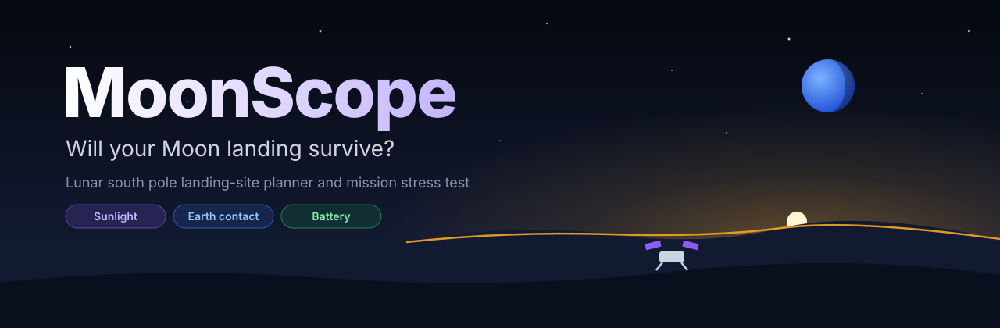
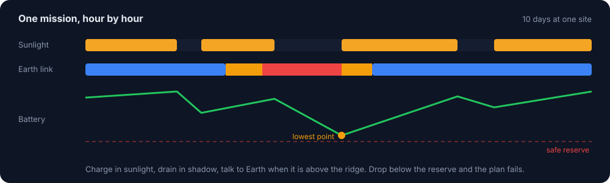
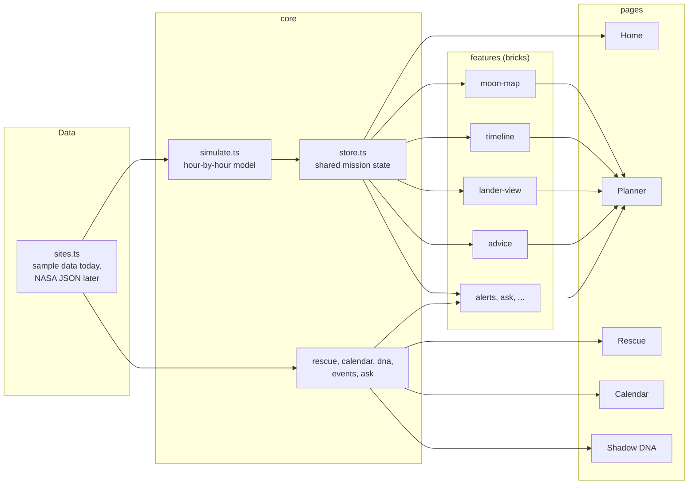

<p align="center">
  
</p>

<p align="center">
  
  
  
  
  
</p>

<p align="center">
  <a href="#what-it-does">What it does</a> &middot;
  <a href="#how-it-works">How it works</a> &middot;
  <a href="#quick-start">Quick start</a> &middot;
  <a href="#architecture">Architecture</a> &middot;
  <a href="#data">Data</a> &middot;
  <a href="#team">Team</a>
</p>

---

At the lunar south pole the Sun never climbs more than a few degrees above the horizon. A ridge a few kilometres away can put a
lander in shadow for days, and the same terrain can hide Earth and cut the radio link. A landing site that looks perfect on one date
can kill the mission two days later.

**MoonScope** answers one question: *will this mission survive?* Pick a site and a landing date, set the lander's battery and power
use, and MoonScope simulates every hour of the mission. It shows when the panels charge, when Earth is in view, how low the battery
falls, and the smallest change that turns a failing plan into a working one.

## What it does

| Page | Route | What you get |
| :--- | :--- | :--- |
| **Home** | `#/` | What MoonScope is, with a live verdict for the current plan |
| **Mission planner** | `#/plan` | The full dashboard: site map, sky view, mission settings, timeline, 360 degree lander view, site comparison, fixes, alerts and Ask MoonScope |
| **Rescue Mode** | `#/rescue` | A 60-second game. Something breaks after touchdown and you have 72 hours to keep the lander alive |
| **Survival Calendar** | `#/calendar` | Sixty landing dates coloured by result, with the earliest date the mission fails |
| **Shadow DNA** | `#/sites` | A ring fingerprint of light and Earth contact for every site, side by side |

### Inside the planner

| Brick | Purpose |
| :--- | :--- |
| Moon map | Five south-pole sites, each dot coloured by its verdict for your current settings |
| Local sky | Where the Sun and Earth sit above the horizon right now |
| Mission settings | Site, landing date, battery, power use, panel efficiency, Earth-contact hours, mission length |
| Metrics | Lowest battery, sunlit hours, Earth contact and the verdict |
| Timeline | Hour-by-hour sunlight and Earth-link bars with a playable cursor |
| Lander's-eye view | A 360 degree panorama of the horizon, the Sun's path and Earth |
| Compare | Every site under the same settings |
| Advice | Why the plan fails, plus one-click fixes (land later, switch site) |
| Mission alerts | Readable events: sunset, signal loss, battery below reserve. Click one to jump there |
| Ask MoonScope | Type *"land 3 days late with 20% weaker panels"* and the plan updates. No AI key needed |

### Rescue Mode

Choose a crisis (dust on the panels, a late landing or a stuck heater). The game starts just before sunset with the battery at 35%.
Every move re-runs the simulator:

| Move | Effect | Cost |
| :--- | :--- | :--- |
| Drive 1 km toward sunlight | Lowers the horizon so the Sun clears it sooner | 2 hours and 4 kWh, up to 3 times |
| Switch off instruments | Cuts power use by 40% | Science pauses |
| Hibernate for 6 hours | Power use drops to 0.4 kW | No science, no contact |
| Tilt panels to the Sun | 15% more power from the panels | Once only |

Doing nothing always loses. Easy sites need one good move; hard sites need a combination.

## How it works

<p align="center">
  
</p>

For every hour of the mission MoonScope checks three things:

1. **Is the Sun above the local horizon?** The Sun's elevation and direction are compared with the terrain height in that direction.
   If it clears the ridge, the panels charge.
2. **Can the lander see Earth?** The same test for Earth gives a good, weak or lost link.
3. **What is left in the battery?**

```text
battery[h + 1] = min(capacity, battery[h] + solar_power[h] - power_use)
solar_power[h] = sunlit[h] ? 1.361 kW/m2 x 10 m2 x panel_efficiency : 0
```

The plan **fails** if the battery drops below the safe reserve, or if daily Earth contact falls short of what the mission needs. It is
**at risk** if it only just passes. MoonScope then reruns the mission with later landing dates and other sites to find the smallest fix,
and stress-tests a working plan against 1, 3 and 5 day launch delays.

## Quick start

You need **Node.js 20 or later** and **pnpm**.

```bash
git clone https://github.com/sasasaee/Team-merge_conflict.git
cd Team-merge_conflict
pnpm --dir web install
pnpm dev
```

Open <http://localhost:5173>.

| Command | What it does |
| :--- | :--- |
| `pnpm dev` | Start the dev server with hot reload |
| `pnpm build` | Type-check and build to `web/dist` |
| `pnpm --dir web preview` | Serve the production build locally |

## Architecture

MoonScope is built like Lego. Every panel is a self-contained **brick** that reads shared state from `core` and draws with pieces
from `ui`. Bricks never import each other, so five people can work on five bricks without merge conflicts.



### Folder structure

```text
moonscope/
|-- package.json            root scripts: pnpm dev, pnpm build
|-- docs/                   README images
`-- web/
    |-- index.html
    |-- public/             favicon, later data/<site>.json
    `-- src/
        |-- app/            App.tsx, page switcher, global styles
        |-- core/           data, simulator, shared state (no UI)
        |-- ui/             Panel, Badge, Slider, NavBar, theme colours
        |-- features/       one folder per brick
        |   |-- moon-map/
        |   |-- local-sky/
        |   |-- mission-form/
        |   |-- metrics/
        |   |-- timeline/
        |   |-- lander-view/
        |   |-- compare/
        |   |-- advice/
        |   |-- alerts/
        |   `-- ask/
        `-- pages/          home, planner, rescue, calendar, sites
```

### Import rules

| Folder | May import from |
| :--- | :--- |
| `core` | nothing inside `src` |
| `ui` | nothing inside `src` |
| `features/*` | `@/core`, `@/ui` |
| `pages/*` | `@/core`, `@/ui`, `@/features/*` |

### Add a new brick

1. Create `web/src/features/my-brick/MyBrick.tsx`:

   ```tsx
   import { useSim } from "@/core";

   export function MyBrick() {
     const r = useSim();
     return <p>Lowest battery: {r.minSoc.toFixed(0)} kWh</p>;
   }
   ```

2. Create `web/src/features/my-brick/index.ts`:

   ```ts
   import { Box } from "lucide-react";
   import type { Block } from "@/ui";
   import { MyBrick } from "./MyBrick";

   export const myBrick: Block = { id: "my-brick", title: "My brick", icon: Box, span: "lg:col-span-6", Component: MyBrick };
   ```

3. Add `myBrick` to the list in `web/src/pages/planner/blocks.ts`. That is the only shared file you touch.

## Data

The prototype runs on **sample data** generated in `web/src/core/sites.ts`, shaped exactly like the real data will be:
one lunar month (672 hours) per site with Sun and Earth positions, the terrain horizon and the Earth link state.

The real pipeline replaces it with one JSON file per site in `web/public/data/`, built from:

| Source | Used for |
| :--- | :--- |
| [NASA LRO LOLA](https://pds-geosciences.wustl.edu/missions/lro/lola.htm) elevation models | Terrain horizon around each site |
| [NASA NAIF SPICE](https://naif.jpl.nasa.gov/naif/) ephemerides | Sun and Earth direction from each site, hour by hour |
| [NASA SVS CGI Moon Kit](https://svs.gsfc.nasa.gov/4720) | Moon imagery on the site map |

## Roadmap

- [x] Hour-by-hour power and communication simulator
- [x] Mission planner with fixes and delay stress test
- [x] Rescue Mode, Survival Calendar, Shadow DNA
- [x] Lander's-eye view, alert feed, Ask MoonScope
- [ ] Real horizons from LOLA elevation data
- [ ] Real Sun and Earth positions from SPICE
- [ ] 3D Moon globe
- [ ] Public deployment

## Team

**Merge_Conflict**, NASA Space Apps Challenge 2026.

| Role | Member | Focus |
| :--- | :--- | :--- |
| R0 | Noshin Syara | UI/UX design and frontend lead |
| R1 | Atia | Sun and Earth position data (Python, SPICE) |
| R2 | Humaira | Moon terrain and shadow data (Python, LOLA) |
| R3 | Saeera | Mission simulator logic (TypeScript) |
| R4 | Salsabil | 3D Moon, backend and deployment |